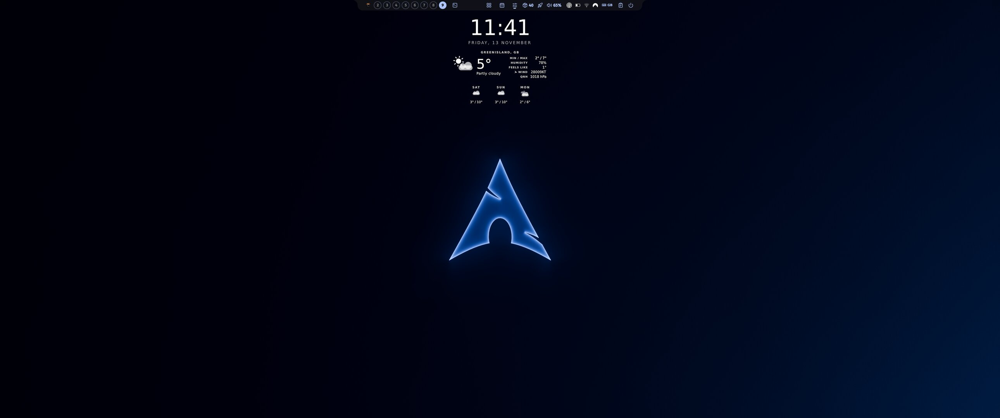
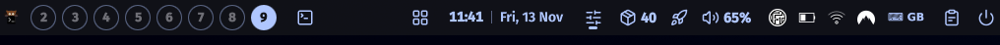
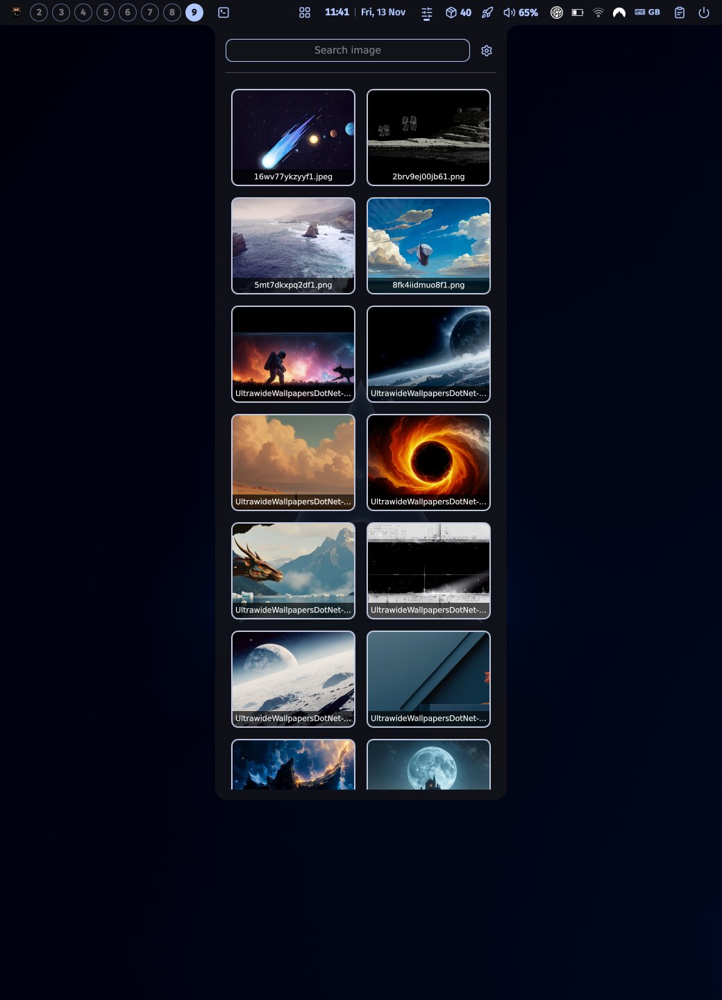
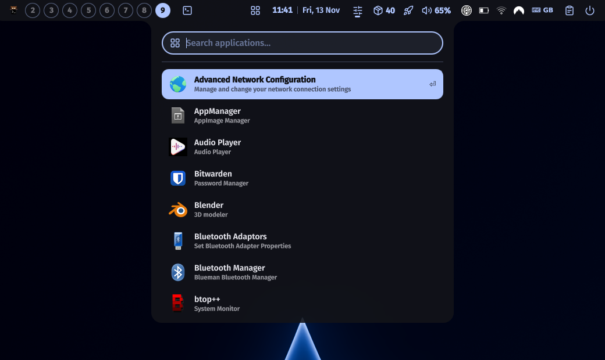

# dotfilesPC

Configuration files for a Hyprland desktop on Arch Linux, managed with
[GNU Stow](https://www.gnu.org/software/stow/). This repository is for the
desktop PC: an NVIDIA GPU and a single 3440×1440 ultrawide monitor at 75 Hz.
The laptop has its own repository,
[dotfilesLaptop](https://github.com/g-machado-uu/dotfilesLaptop), which shares
most of the desktop but has its own monitors, environment and package choices.

The configuration derives from
[ML4W OS](https://github.com/mylinuxforwork/dotfiles) 2.14.1 by Stephan Raabe.
The principal modification is a Quickshell status bar from which every panel of
the desktop is opened. A time and weather widget occupies empty workspaces.

The modifications to the ML4W files are listed under
[Changes from ML4W](#changes-from-ml4w). The configuration was developed with
the assistance of Claude (Anthropic).



## Screenshots

All screenshots were taken on this PC. The modules of the status bar are
defined in `~/.config/ml4w/settings/statusbar.json`, following the ML4W
convention.



The control centre (`SUPER + CTRL + S`) contains network and Bluetooth tiles,
Do Not Disturb, Caffeine, Night Light, Gamemode, audio and brightness sliders,
an Appearance page, the weather and the active media player.


The Settings panel (`SUPER + SHIFT + S`) replaces the separate ML4W settings
application.


The wallpaper picker (`SUPER + CTRL + W`). Selecting a wallpaper runs matugen,
which regenerates the colours of the bar, GTK, kitty, rofi, btop, swaync and
Firefox.



The application launcher (`SUPER + CTRL + RETURN`, or the launcher icon in the
bar) drops from the bar like the other panels. It lists the installed
applications with their icons and filters them as you type.



## Repository structure

Each top level directory is a Stow package whose contents mirror the home
directory. For example, `hypr/.config/hypr` is linked to `~/.config/hypr`.

| Package | Target | Content |
| --- | --- | --- |
| `hypr` | `~/.config/hypr` | Hyprland configuration in Lua, keybindings in `conf/keybindings/gabriel.lua`, hypridle and hyprlock |
| `quickshell` | `~/.config/quickshell` | Status bar, desktop widget and all panels, including Settings and the overview |
| `ml4w` | `~/.config/ml4w` | ML4W scripts in use (wallpaper, clipboard, updates, toggles) and settings files |
| `matugen` | `~/.config/matugen` | Templates for the colour scheme derived from the wallpaper, including Pywalfox for Firefox |
| `rofi`, `swaync`, `kitty`, `fastfetch`, `btop`, `qt6ct` | `~/.config/...` | Application configuration |
| `nvim` | `~/.config/nvim` | LazyVim with LSP, DAP for C, LaTeX and snippets |
| `vim` | `~/.config/vim/.vimrc` | Minimal vim configuration for systems without Neovim |
| `tmux` | `~/.config/tmux` | tmux with `C-Space` as prefix and TPM plugins |
| `yazi` | `~/.config/yazi` | yazi file manager with additional "Open with" entries |
| `voxtype` | `~/.config/voxtype` | Push to talk dictation |
| `browserflags` | `~/.config/chromium-flags.conf`, `~/.config/edge-flags.conf` | Wayland flags for Chromium based browsers |
| `mimeapps` | `~/.config/mimeapps.list` | Default applications (Vivaldi for web links, Okular for PDF) |
| `gtk-2.0`, `gtk-3.0`, `gtk-4.0`, `xsettingsd`, `xresources` | `~/.gtkrc-2.0`, `~/.config/...`, `~/.Xresources` | GTK theme, ArcStarry cursor and kora icons |
| `fonts` | `~/.local/share/fonts` | Fira Sans, used by the bar, rofi and hyprlock |
| `cursors` | `~/.local/share/icons/ArcStarry-cursors` | Cursor theme |
| `zsh` | `~/.zshrc` | Shell configuration |
| `git` | `~/.gitconfig` | Git identity and default branch |
| `ohmyposh` | `~/Documents/mytheme_v2.toml` | Prompt theme loaded by `.zshrc` |
| `systemd` | `~/.config/systemd/user/hyprland-session.target` | Session target started by `autostart.lua` |
| `xdg-desktop-portal` | `~/.config/xdg-desktop-portal/portals.conf` | Hyprland portal as first preference |
| `wallpapers` | `~/Pictures/Wallpapers` | ML4W's wallpapers, read by the wallpaper picker |
| `system` | `/etc/sddm.conf`, `/usr/share/sddm/themes/ml4w` | SDDM configuration and theme. Copied as root, not stowed |

### What is specific to this PC

* **Monitor:** `hypr/.config/hypr/hyprland-gui.lua` (written by HyprMod,
  profiles in `hypr/.config/hypr/hyprmod/`) sets one monitor, `DP-1` at
  3440×1440 and 74.98 Hz, scale 1. The outer gaps are 13 px.
* **NVIDIA:** `conf/environment.lua` loads the `nvidia.lua` variant, which can
  be changed in the System tab of the Settings panel.
* **Input:** the keyboard layout is set in `hypr/.config/hypr/input.lua`.
* **Wallpaper folder:** `~/Pictures/Wallpapers`
  (`ml4w/.config/ml4w/settings/wallpaper-folder`).
* **Weather location:** stored in `ml4w/.config/ml4w/settings/statusbar.json`.

## Installation

The procedure assumes a minimal Arch Linux installation with a working network
connection and a user with `sudo` rights.

### 1. AUR helper

```bash
sudo pacman -S --needed base-devel git
git clone https://aur.archlinux.org/paru-bin.git
cd paru-bin && makepkg -si
```

### 2. Packages

`packages-arch.txt` contains every package the desktop requires, including the
dependencies of the qylock lock screen (Qt 6 Declarative, 5Compat and
Multimedia, and the GStreamer plugins) and `fuse2`/`fuse3` for AppImages. AUR
packages are marked with a comment.

```bash
git clone git@github.com:g-machado-uu/dotfilesPC.git ~/.dotfilesPC
cd ~/.dotfilesPC
paru -S --needed $(grep -v '^#' packages-arch.txt)
```

`packages-arch-apps.txt` lists the remaining applications in use, grouped by
purpose, including the NVIDIA drivers this PC needs.

```bash
paru -S --needed $(grep -v '^#' packages-arch-apps.txt)
```

### 3. Browsers

Two browsers are configured. Vivaldi is the default browser (`SUPER + B` and
`mimeapps.list`). Firefox has its own keybinding (`SUPER + CTRL + F`) and
receives the matugen colour scheme through Pywalfox.

```bash
paru -S --needed vivaldi vivaldi-ffmpeg-codecs firefox python-pywalfox
pywalfox install
```

The Pywalfox extension must then be installed in Firefox from
addons.mozilla.org. The wallpaper script calls `pywalfox update` after each
wallpaper change.

### 4. Stow the packages

Existing files at the target locations must be moved before stowing, since
Stow does not overwrite them. `~/.zshrc` and `~/.gitconfig` are the usual
cases.

```bash
cd ~/.dotfilesPC
mkdir -p ~/.config ~/.local/share/icons ~/Documents ~/Pictures
stow hypr quickshell ml4w matugen rofi swaync kitty fastfetch btop qt6ct \
     nvim vim yazi browserflags mimeapps gtk-2.0 gtk-3.0 gtk-4.0 \
     xsettingsd xresources fonts cursors zsh git
stow --no-folding systemd xdg-desktop-portal ohmyposh tmux voxtype wallpapers
fc-cache -f
```

The parent directories are created first. On a fresh home directory, Stow
would otherwise turn `~/.config` itself into a link into the repository.

The packages in the second `stow` line require `--no-folding`, because other
programs write into the same directories: TPM installs plugins into
`~/.config/tmux/plugins`, voxtype keeps a `config.toml.bak`, and wallpapers are
added to `~/Pictures/Wallpapers` locally. Without it those files would end up in
the repository. The same applies to `~/.local/share/icons`, which is created as
a regular directory before `cursors` is stowed.

Enabled systemd user units are not part of the repository. After stowing
`systemd`, re-enable them, for example `systemctl --user enable voxtype`.

### 5. Wallpapers

The `wallpapers` package contains only ML4W's wallpapers. `default.jpg` is the
fallback used by the scripts. Personal wallpapers are kept outside the
repository (here in `~/Dropbox/Wallpapers`) and linked file by file into
`~/Pictures/Wallpapers`, since the wallpaper picker does not read
subdirectories:

```bash
ln -s ~/Dropbox/Wallpapers/* ~/Pictures/Wallpapers/
```

Do not add these wallpapers to the repository. Most are licensed for personal
use only.

### 6. Login manager

The `system` package targets `/` and contains files read by SDDM before login.
These are copied rather than linked, since SDDM cannot follow links into a
home directory. The theme is SilentSDDM as shipped by ML4W's `ml4w-sddm`, with
its own background (`backgrounds/ml4w.jpg`) and date format, selected by
`configs/ml4w.conf`.

```bash
sudo cp system/etc/sddm.conf /etc/sddm.conf
sudo cp -r system/usr/share/sddm/themes/ml4w /usr/share/sddm/themes/
sudo systemctl enable sddm
```

### 7. Lock screen

The lock screen is the `field` theme of
[qylock](https://github.com/Darkkal44/qylock), a collection of Quickshell and
SDDM lock screen themes. It is not part of this repository. Its dependencies
are in `packages-arch.txt`. The repository is cloned to `~/Projects` and its
Quickshell installer is run, which installs the lock screen to
`~/.local/share/quickshell-lockscreen` and links the themes back to the clone.

```bash
git clone https://github.com/Darkkal44/qylock.git ~/Projects/qylock
cd ~/Projects/qylock
chmod +x quickshell.sh && ./quickshell.sh
```

The clone must remain in place, since the installed lock screen reads its
themes from it. Only the Quickshell part of qylock is used. SDDM keeps the ML4W
theme from step 6.

### 8. Shell and terminal multiplexer

```bash
chsh -s /usr/bin/zsh
git clone https://github.com/tmux-plugins/tpm ~/.tmux/plugins/tpm
```

The tmux plugins are installed from within tmux with `C-Space I`.

### 9. Session

Hyprland is selected at the SDDM login screen. SDDM starts plain
`hyprland.desktop`, not uwsm, so `autostart.lua` starts
`hyprland-session.target`, which brings up `graphical-session.target` and the
units that depend on it, such as voxtype.

## Time and weather widget

The widget is displayed on empty workspaces only. When a window opens, the
widget is absorbed into the bar, which resumes displaying the clock. On an
empty workspace the clock in the bar is replaced by a calendar button. The
widget can be disabled from the Appearance page of the control centre.

The widget has three sections: time and date, current conditions, and a three
day forecast. Weather data is obtained from
[Open-Meteo](https://open-meteo.com/), which requires no API key. The data is
refreshed every 15 minutes. Until the first successful request the widget
retries every 20 seconds, since the network is often unavailable at login.

Wind is reported in METAR notation. `23009G19KT` denotes 230 degrees at 9 knots
with gusts of 19 knots. Gusts are reported only when they exceed the mean
speed by 10 knots or more. `QNH` is the pressure at mean sea level in hPa.

The text colour is chosen from the brightness of the wallpaper behind the
widget, independently of the light or dark palette selected by matugen.

The size of the widget and its return delay are set in the Statusbar tab of the
Settings panel (`weather.widgetScale`, default 0.8, and `weather.showDelay`,
default 600 ms, in `statusbar.json`). The delay is the time a workspace must
stay empty before the widget comes back out. It prevents the widget from
bouncing in and out while an application that briefly closes its window during
start-up is loading. The widget is still absorbed into the bar without delay.

```bash
qs ipc call statusbar setWeatherWidgetScale 0.9    # 0.5 to 1.5
qs ipc call statusbar setWeatherShowDelay 1000     # 0 to 10000 ms
```

The location is set in any of three places:

* the Statusbar tab of the Settings panel
* the place name above the weather in the control centre, which becomes a text
  field when clicked
* the IPC interface of the bar

```bash
qs ipc call statusbar weatherLocation
qs ipc call statusbar setWeatherLocation "Porto, PT"
```

## Settings panel

The Settings panel opens with `SUPER + SHIFT + S`, from the control centre, or
with `qs ipc call settings toggle`. It has four tabs.

* **Appearance:** rofi border and font, wallpaper blur, and the animation,
  decoration, window, layout and workspace variants.
* **Default apps:** terminal, browser, email client, file manager, network and
  Bluetooth managers, software manager, calculator, screenshot editor, system
  monitor and AUR helper.
* **Statusbar:** weather location, and the size and return delay of the time
  and weather widget.
* **System:** keybinding, monitor, environment (here `nvidia`) and window rule
  variants.

The entries are defined in
`quickshell/.config/quickshell/SettingsApp/settings.json`. Each entry declares
its storage method: `replace` edits one line of a file, `overwrite` rewrites the
file, and `command` runs a read command and a write command. Changing a
Hyprland variant triggers `hyprctl reload`.

## Keybindings

`SUPER` is the modifier. `SUPER + CTRL + K` displays the complete list. The
source is `hypr/.config/hypr/conf/keybindings/gabriel.lua`.

| Keys | Action |
| --- | --- |
| `SUPER + RETURN` | Terminal (kitty) |
| `SUPER + B` | Default browser (Vivaldi) |
| `SUPER + CTRL + F` | Firefox |
| `SUPER + E` | File manager |
| `SUPER + CTRL + RETURN` | Application launcher |
| `SUPER + TAB` | Workspace overview |
| `SUPER + SPACE` | Expand the bar and give it keyboard focus |
| `SUPER + CTRL + S` | Control centre |
| `SUPER + SHIFT + S` | Settings panel |
| `SUPER + CTRL + W` | Wallpaper picker |
| `SUPER + V` | Clipboard history |
| `SUPER + ALT + M` | System monitor panel |
| `SUPER + SHIFT + M` | Toggle light and dark mode |
| `SUPER + CTRL + M` | Voxtype dictation, held while speaking |
| `SUPER + CTRL + P` | Power menu |
| `SUPER + CTRL + L` | Lock screen |
| `SUPER + Q` | Close the open bar panel, or the active window |
| `SUPER + ALT + F` | Full screen screenshot |
| `SUPER + ALT + S` | Area screenshot |
| `SUPER + ALT + A` | Text extraction from an area (tesseract) |

## Application launcher

The launcher replaces rofi's `drun` mode. It reads the same `.desktop` files
through Quickshell, so it lists the same applications. The source is
`quickshell/.config/quickshell/LauncherApp/LauncherPanel.qml`.

* **Search:** names that start with the query rank first, then words in the
  name that start with it, then the generic name and keywords, then the
  description. Letters typed in order also match, so `vsc` finds Visual Studio
  Code.
* **Most used first:** each launch is counted in
  `~/.local/state/quickshell/by-shell/<id>/launcher-usage.json`. The most used
  applications head the list when the search is empty and are ranked higher in
  the results. The file is per machine and not part of the repository.
* **Keys:** `Up` and `Down`, `Tab` and `Shift + Tab`, or `Ctrl + J` and
  `Ctrl + K` move the selection. `Page Up` and `Page Down` move eight entries.
  `Return` launches and `Escape` closes.
* **Terminal applications** are opened in the terminal set in the Default apps
  tab of the Settings panel.

The launcher is also opened with `qs ipc call launcher toggle`. Rofi remains
installed for the screenshot, OCR and keybinding menus, and
`hypr/.config/hypr/scripts/launcher.sh` still opens its launcher.

## Memory use

The bar panels are created when they open and destroyed shortly after they
close, instead of existing from startup. The workspace overview runs inside
the main Quickshell process and is loaded when it is first opened. It is
unloaded after one minute closed. `ml4w-autostart` no longer starts a second
`qs` process for it.

## Power menu and screen lock

Logout, reboot and power off are executed through `hyprshutdown`, as
recommended by the
[Hyprland wiki](https://wiki.hypr.land/Hypr-Ecosystem/hyprshutdown/). This asks
each application to close before Hyprland exits.

Locking is performed through `loginctl lock-session`, which hypridle handles.
The lock command in `hypridle.conf` and in the keybinding calls
`~/.local/share/quickshell-lockscreen/lock.sh`, the Quickshell lock screen
from qylock (see [Lock screen](#7-lock-screen)). `lock.sh` uses the `field`
theme unless another theme name is passed as its first argument, for example
`lock.sh clockwork/tape`. The previous hyprlock commands remain as comments in
both files.

This PC uses SDDM with an NVIDIA GPU. If logging out leaves a black screen,
add `--vt <n>` to the `hyprshutdown` calls in
`quickshell/.config/quickshell/PowerApp/PowerPanel.qml`, where `n` is the
virtual terminal used by SDDM.

## Notifications

Notifications are handled by swaync. The control centre displays the number of
pending notifications and opens the swaync window.

## Changes from ML4W

**Removed**

* waybar and its themes
* the ML4W dock (nwg-dock-hyprland)
* the walker, waypaper and wlogout configurations
* the welcome application and the ML4W settings application
* the theme switcher (`ml4w/themes`), which only affected waybar, the dock and
  walker
* the ML4W installation and update scripts
* approximately 20 scripts without callers
* matugen outputs for the removed applications

**Replaced**

* the settings application, by the Settings panel
* `ml4w-power`, by `hyprshutdown`
* the launcher script, by the Quickshell launcher
* the status bar toggle and reload scripts, by Quickshell IPC calls

**Modified**

* **Sidebar:** merged into the control centre. Duplicated controls were
  removed. Gamemode became a tile, and the theme tools moved to the Appearance
  page.
* **`SUPER + Q`:** closes an open bar panel before closing windows.
* **Wallpaper script and GTK theme listener:** no longer restart waybar or the
  dock. The wallpaper script also updates Pywalfox.
* **Autostart:** the log is written to `~/.cache/ml4w-autostart.log`, and the
  overview is no longer started as a separate process.
* **Retained:** the paths under `~/.config/ml4w` and the `ml4w-wallpaper`
  script, so that existing callers remain valid.

**Added**

* the Quickshell bar and its panels
* the keyboard layout indicator
* the time and weather widget
* the application launcher
* the keybindings and the fluidDrop animation
* the window rules, and the hypridle, kitty, fastfetch, nvim, vim, tmux and
  voxtype configurations
* the SDDM theme configuration in `system/`

`ML4W_BASELINE` records the upstream version. `./upstream-diff.sh` lists the
upstream changes since that version in the directories this repository
replaces. `./upstream-diff.sh --mine` lists the local changes relative to the
baseline.

## Known limitations

* **Lock screen:** depends on qylock, which is installed separately. Without
  it, `SUPER + CTRL + L` and the idle timeout do not lock the session.
* **Filen:** `autostart.lua` starts `~/Applications/Filen`, an AppImage that is
  installed manually. AppImages require `fuse2`, which is in
  `packages-arch.txt`.
* **`SUPER + CTRL + C`** is bound twice, to the calculator and to the calendar.
* **Bubble system monitor:** `quickshell/.config/quickshell/SysMonitor` is
  kept but no longer started. `SUPER + ALT + M` opens the System panel of the
  bar instead.

## Credits and licences

* **ML4W OS** by Stephan Raabe, GPL 3.0. The basis of this configuration, the
  SDDM theme setup and the source of the wallpapers in the `wallpapers`
  package.
* **Files derived from ML4W:** GPL 3.0 (`LICENSE`).
* **SilentSDDM**, the SDDM theme installed by ML4W.
* **Fira Sans:** SIL Open Font License
  (`fonts/.local/share/fonts/Fira_Sans/OFL.txt`).
* **ArcStarry cursors:** GPL 3.0.
* **`quickshell/overview`:** a separate project with its own README. The main
  shell loads it on demand instead of running it as a second Quickshell
  process.
* **qylock** by Darkkal44, the lock screen. Installed separately, not
  redistributed here.
